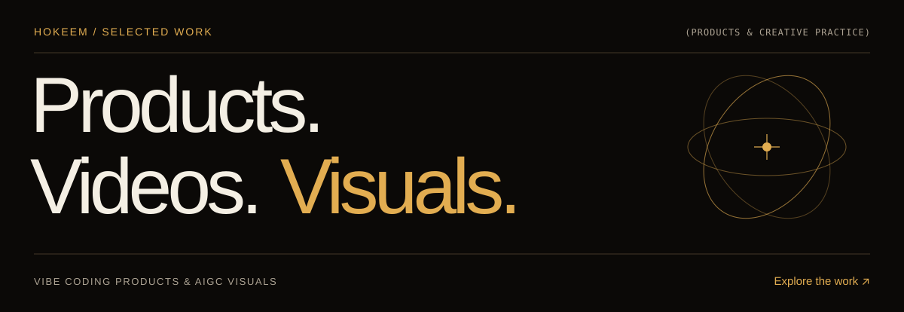
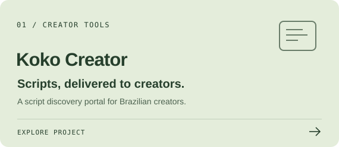
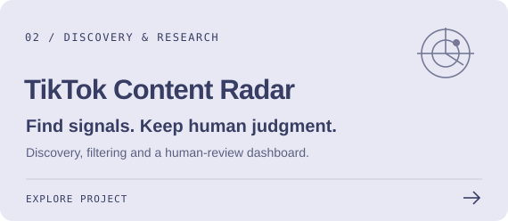
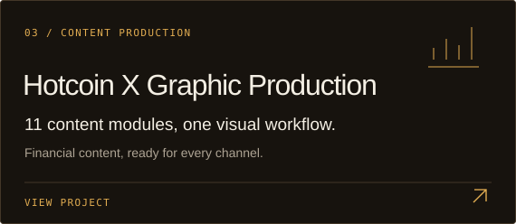
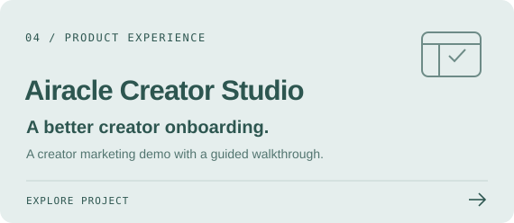
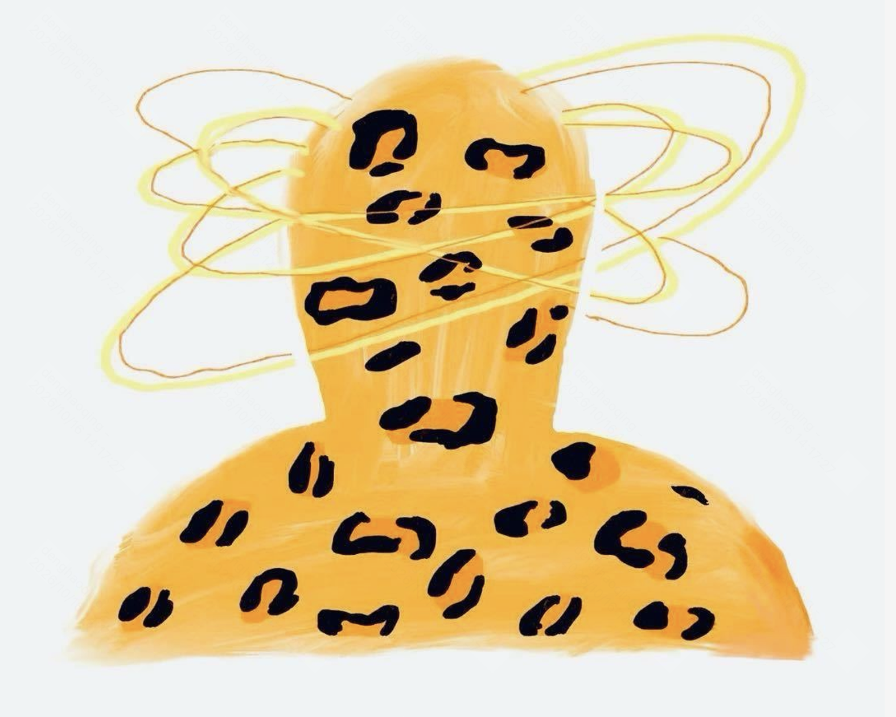

  <a href="https://hokeem.top/"><b>Portfolio ↗</b></a>
  &nbsp;&nbsp; / &nbsp;&nbsp;
  <a href="https://hokeem.top/#about">About Me</a>
  &nbsp;&nbsp; / &nbsp;&nbsp;
  <a href="https://hokeem.top/#contact">Let's Connect</a>

### Hokeem / 阿豹

I create at the intersection of **AI products, content, and growth**. My work spans tools for creators, content production systems, AI films, short dramas, and visual experiments.

我把运营中的真实需求做成产品，也用 AI 创作视频和视觉作品。这里是我的工具、工作流与持续迭代的实验；完整的产品 Demo 和创作案例可以在 [hokeem.top](https://hokeem.top/) 体验。

 

## (01) / Selected Builds

Tools shaped by real work — creator discovery, content production, and collaboration.

<table>
  <tr>
    <td width="50%">
      
      面向巴西创作者的脚本发现与推荐门户。
    </td>
    <td width="50%">
      
      TikTok 内容发现、筛选与人工审核工作台。
    </td>
  </tr>
  <tr>
    <td width="50%">
      
      美股内容的选题、制作、发布与复盘工作流。
    </td>
    <td width="50%">
      
      包含引导教程的创作者营销前端 Demo。
    </td>
  </tr>
</table>

## (02) / Creative Practice

**[Films & Short Dramas ↗](https://hokeem.top/#work/video)** &nbsp; AI 视觉影片、竖屏短剧与制作案例。  
**[Images & Visuals ↗](https://hokeem.top/#work/image)** &nbsp; 品牌视觉、信息卡片与社交媒体创作。  
**[Product Demos ↗](https://hokeem.top/#work/product)** &nbsp; 创作者工具、内容生产与 KOL 协作产品。

Skills & experiments / 更多工具与实验

- **[English Short Drama Script](https://github.com/hokeem/english-short-drama-script-skill)** — 把中文短剧创意改写为自然的英语竖屏短剧脚本。
- **[Video Analysis](https://github.com/hokeem/Video-analysis-v4)** — 视频分析工具的持续探索与迭代。
- **[Portfolio Source](https://github.com/hokeem/ai-showcase-site)** — 个人作品集网站源码。

Built with Python, TypeScript, JavaScript, and AI workflows.

## (03) / Let's Connect

**HOKEEM / Denghaoqing**  
Content, products, and everything I create.

[Visit my website ↗](https://hokeem.top/) &nbsp; / &nbsp; [Connect ↗](https://hokeem.top/#contact)

---

HOKEEM / SELECTED WORK · 从真实问题出发，留下属于自己的创作。
